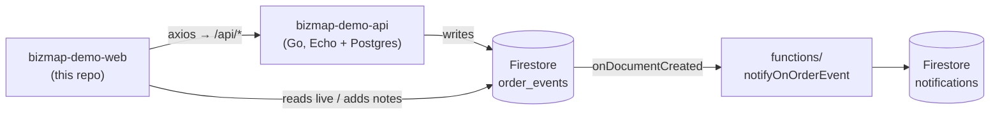

# bizmap-demo-web

TypeScript storefront (axios + Firebase) for **Northwind Outfitters**, a
fictitious shop. It is half of a two-repo demo of [BizMap](https://github.com/lucas-simao/bizmap):
the other half is the Go API, [bizmap-demo-api](https://github.com/lucas-simao/bizmap-demo-api).

**Live map of both repos:** https://lucas-simao.github.io/bizmap-demo-web/



## What is here

| Screen / function | Calls | Data reached (in the api repo) |
| --- | --- | --- |
| `src/screens/signup.ts` | `POST /api/customers`, `GET /api/customers/:id` | `customers` |
| `src/screens/catalog.ts` | `GET /api/products` | `products` |
| `src/screens/checkout.ts` | `POST /api/orders`, `/pay`, `/cancel` | `orders`, `order_items`, `products.stock_reserved`, `payments` |
| `src/screens/orderTimeline.ts` | Firestore `order_events` (live query + notes), `GET /api/orders/:id` | `order_events`, `orders` |
| `functions/src/index.ts` | trigger on `order_events/{eventId}` | writes `notifications` |

## What BizMap shows here

- A front-end function is linked to the **Go route it calls** and, through it,
  to the Postgres columns that route writes: `bizmap why orders.discount_cents`
  ends with *invoked via HTTP from web/src.screens.checkout.placeOrder*.
- `order_events` is **one** collection written by both repos:
  `bizmap who-writes order_events` lists the API routes, the expiry job and
  `addCustomerNote` here.
- The PR comment of a front-end change lists the tables it reaches in the
  other repo (*crosses services: web → api*). See the open PRs.

## Try it locally

```bash
pip install bizmap==0.16.2
git clone https://github.com/lucas-simao/bizmap-demo-web && cd bizmap-demo-web
git clone https://github.com/lucas-simao/bizmap-demo-api .bizmap/api
bizmap scan .bizmap --out bizmap.graph.json        # both repos together
bizmap who-writes order_events
bizmap trace order_events
bizmap export --format html --config .bizmap/bizmap.yaml --out bizmap.html
bizmap mcp --graph "$PWD/bizmap.graph.json"        # for Cursor / Claude, see the api README
```

## Files

- [`bizmap.yaml`](bizmap.yaml): repo name, shared database, which env var points at the API.
- [`.bizmap/bizmap.yaml`](.bizmap/bizmap.yaml): the two-repo workspace.
- [`.github/workflows/bizmap.yml`](.github/workflows/bizmap.yml): PR impact comment.
- [`.github/workflows/pages.yml`](.github/workflows/pages.yml): publishes the map.

## Em português

Storefront fictício em TypeScript da demo do BizMap. Junto com a
[API em Go](https://github.com/lucas-simao/bizmap-demo-api), mostra como o
BizMap liga a tela que chama a rota às colunas que ela grava no Postgres e à
coleção do Firestore compartilhada. Cada PR recebe o comentário de impacto.

---

All names and data are fictitious.
